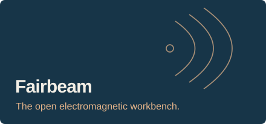
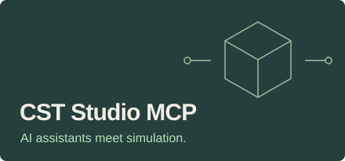
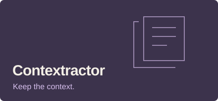
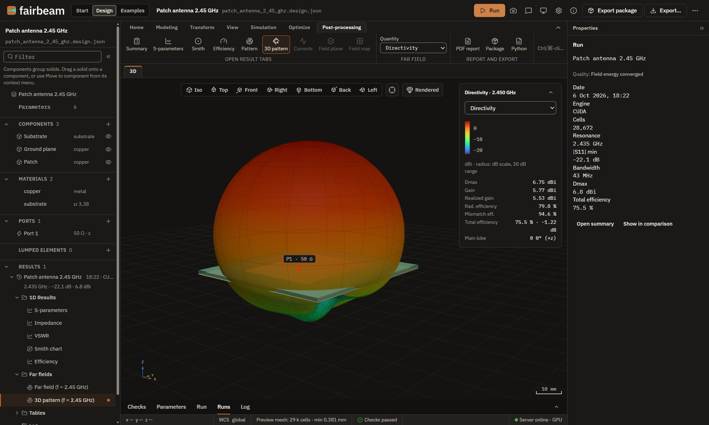

  

I'm İsmail, a PhD Electrical & Electronics Engineer and researcher in İzmir. I build scientific software, tools for working with AI, and small native apps that make everyday work a little better.

**[Research & teaching](https://www.ismailakdag.com) · [Software & projects](https://akdag.dev)**

### What I'm building

<table>
  <tr>
    <td width="50%" valign="top">
      
      Design, simulate and document antennas with <strong>openEMS</strong>.
        
      <a href="https://fairbeam.org">Explore</a> · <a href="https://fairbeam.org/app/">Browser demo</a> · <a href="https://github.com/ismailakdag/fairbeam">Code</a>
    </td>
    <td width="50%" valign="top">
      
      Connect AI assistants to <strong>CST Studio Suite</strong> through structured Python tools.
        
      <a href="https://github.com/ismailakdag/cst-studio-mcp">Code & setup</a> · <a href="https://cst-mcp.akdag.dev">Project</a>
    </td>
  </tr>
</table>

**[Contextractor](https://github.com/ismailakdag/contextractor)** — Search and export local AI sessions from one private, on-device archive.

A look inside Fairbeam

A real application view. Try the read-only example projects in the [browser demo](https://fairbeam.org/app/), or find desktop downloads at [fairbeam.org](https://fairbeam.org).

---

**Working across:** electromagnetics · antenna design · scientific software · AI tooling · native apps

[Google Scholar](https://scholar.google.com/citations?user=sPXPReUAAAAJ) · [LinkedIn](https://www.linkedin.com/in/ismailakdag/) · [Contact](https://www.ismailakdag.com/contact)
